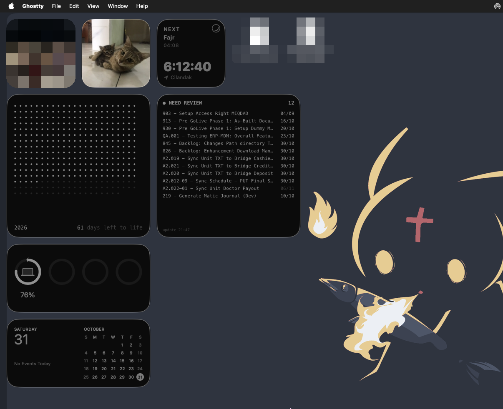
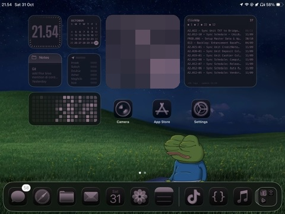
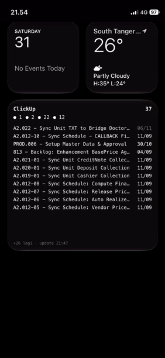

# Scriptable Widgets

[Scriptable](https://scriptable.app) widgets. Compatible with macOS, iPadOS, iOS.

## ClickUp

Widget for assigned tasks in ClickUp.

### Setup
- Fill API token from clickup in [Clickup Settings](https://app.clickup.com/settings/app).
- Paste the token (one time only).

### Preview

#### macOS

#### iPadOS

#### iOS

## Server Stats

Widget for home server stats (CPU, RAM, disk, battery) from Grafana + Prometheus + [node_exporter](https://github.com/prometheus/node_exporter). Small widget shows numbers only, medium/large adds bars. Refreshes every 5 minutes.

### Setup
- In Grafana: Administration → Service accounts → create one with role **Viewer** → Add service account token.
- Get the Prometheus datasource UID from the URL in Connections → Data sources → your Prometheus (`/datasources/edit/<UID>`).
- Copy `Server Stats.js` to Scriptable, run it once and fill Grafana URL, token, and datasource UID (one time only, saved in Keychain).
- One token can be used on every device, run the script once on each device.
- Grafana must be reachable from the device (public domain or VPN like Tailscale).

### Customize
Edit `QUERIES` at the top of `Server Stats.js`. Each key is one row (label + PromQL returning a percentage). Default disks are `/` and `/data`; change the `mountpoint` to match your server. No battery = row shows `—`.
